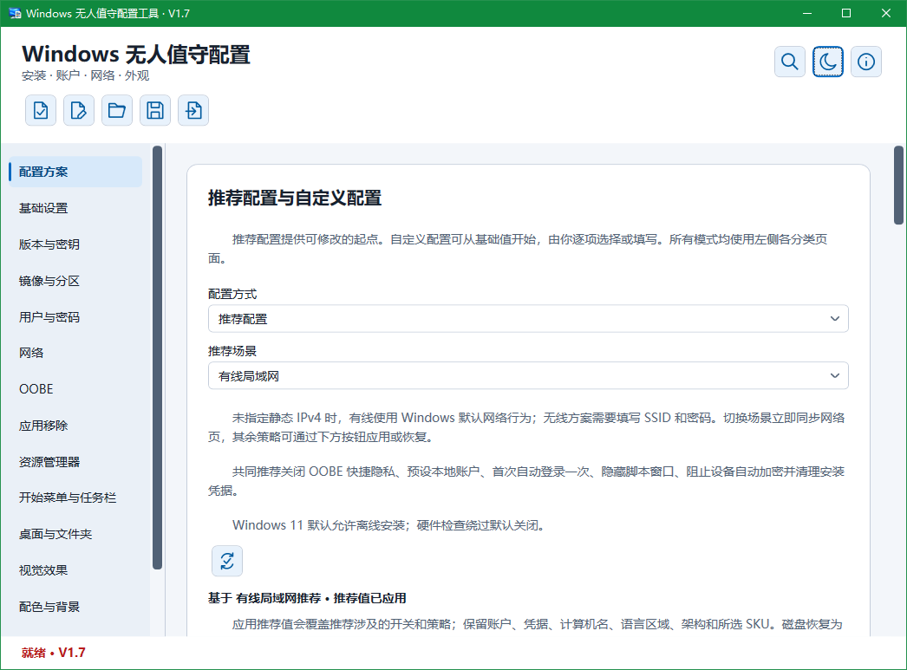
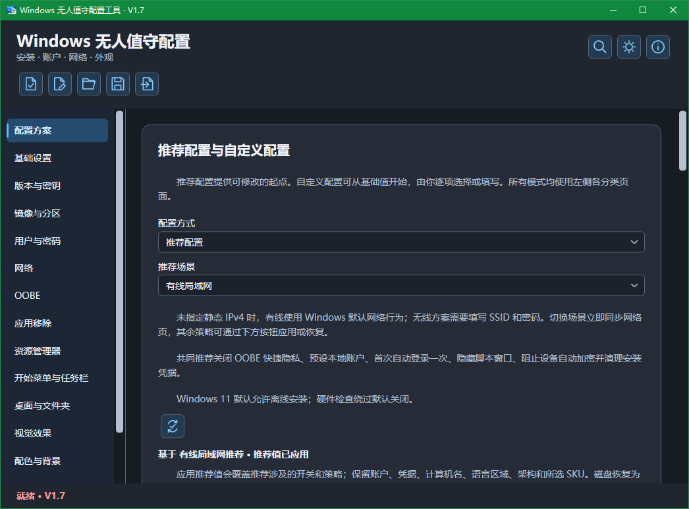
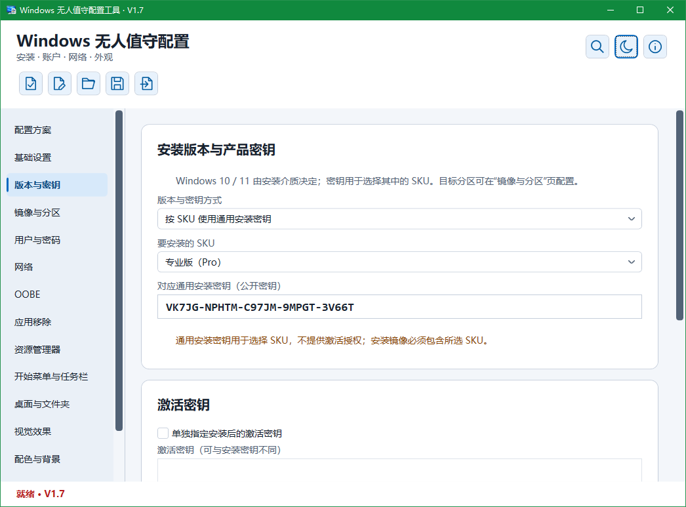

# UnattendLocal — Windows 无人值守配置工具

**简体中文** | [English](README_EN.md)

UnattendLocal 是基于 [Christoph Schneegans 的 UnattendGenerator](https://github.com/cschneegans/unattend-generator) 开发的中文 Windows 桌面配置工具，用于在本地编辑、检查和生成 Windows 10 / 11 的 `autounattend.xml`。

当前版本：**V1.14**。支持静态 IPv4 / IPv6 双栈、子网掩码输入、设置搜索、安装驱动目录、动态更新、自动分区、OOBE 与账户配置，以及已有 XML 的导入编辑。

## 💡 开发初衷

> 方便自己在本地离线配置，也方便下一次直接复用。

最初做 UnattendLocal，是想给自己准备一个可以在本地离线使用的 Windows 安装配置工具。把常用设置保存成方案，重新安装系统或换一台电脑时，直接载入，再根据实际环境调整，让重复的准备工作更省心。

项目以 Christoph Schneegans 的成熟生成核心为基础，将常用选项整理成中文桌面界面，并补上方案保存、配置摘要、检查预览和已有 XML 的导入编辑。希望从选择设置到生成文件，整个过程都更直观，也更容易核对。

现在把它公开，也希望方便有同样需求的人使用，并通过大家的实际测试逐步完善。开发会继续保持小步推进，优先做好常用功能、配置可靠性和安装验证。

这里的离线使用指在本地编辑、保存与生成配置；微软账户登录、联网下载图片或其他联网脚本，仍取决于目标安装环境的网络条件。

## 📸 运行截图

截图版本：**V1.7**。以下为 Windows 上的实际运行界面，拍摄于 2026-10-19。

| 配置方案 · 浅色主题 | 配置方案 · 深色主题 |
| :---: | :---: |
|  |  |

| 版本与密钥 · 浅色主题 | 版本与密钥 · 深色主题 |
| :---: | :---: |
|  |  |

图中的产品密钥为公开通用安装密钥，仅用于选择安装版本，不提供激活授权。

## ✨ 主要功能

- 按目标网卡 MAC 分别配置静态 IPv4 / IPv6，可同时启用双栈；指定地址、前缀、网关和 DNS，IPv4 在同一框填写子网掩码或 /前缀长度。

- 通过右上角“帮助与关于”查看版本、使用说明和内置第三方许可，支持离线查看与复制。

- 通过顶部放大镜或 Ctrl+F 搜索中英文设置名称与别名，按页面分类筛选，切页定位并高亮结果。
- 指定目标 Windows 的工作组名称与 PE 阶段日志目录，保留域加入等未知配置的原文。
- 独立配置 Windows 注册所有者与组织名称，保留登录账户、计算机名与激活设置的独立性。
- 配置安装架构、显示语言、区域、键盘、时区、计算机名及安装版本 / 产品密钥。
- 配置镜像选择、已有分区或自动分区、系统分区大小、分区前暂停及 CompactOS；涉及清空或格式化时显示风险说明并要求核对。
- 配置安装阶段动态更新与界面显示行为，以及目标 Windows PE 可访问的 INF 驱动目录。
- 配置本地账户、内置 Administrator 首次登录、密码、密码到期与锁定策略，以及 WPA2 / WPA3 / 开放 Wi-Fi、无线配置 XML、离线安装和 OOBE。
- 配置资源管理器、开始菜单、任务栏、系统桌面图标、视觉效果、配色、纯色或图片背景及锁屏图片。
- 按项选择 60 个应用与系统能力移除项目，提供中文影响说明、关键词搜索和选择摘要，默认不勾选。
- 配置 `$OEM$` 安装介质配置集与 AppLocker 策略 XML，提供策略编辑及结构检查。
- 配置讲述人辅助安装、Edge 卸载入口和 C 盘系统还原行为，三项默认不勾选。
- 配置 VMware、VirtualBox、KVM / QEMU（VirtIO）和 Parallels 的工具安装，附带所需介质及作用范围说明。
- 配置常用系统行为，包括快速启动、长路径、系统声音、设备自动加密、硬件关联应用、更新自动重启、NTFS 最后访问时间、进程创建审计、UAC / WPBT 及远程桌面 / PowerShell 执行策略等选项。
- 按原设计管理 System、DefaultUser、FirstLogon、UserOnce 自定义脚本；支持复制条目，副本默认停用供核对。
- 保存和恢复 JSON 方案，提供配置摘要、推荐差异、检查、脱敏预览和 XML 导出。
- 导入已有 XML 后编辑已支持设置，保留未知内容；遇到无法可靠合并的修改时停止导出并说明原因。

## V1.14 快捷预设与高级 XML 组件 · 2026-10-22

- 新增“最小配置”预设：安装时选择语言、版本、分区及账户，其余常用设置采用 Windows 默认行为；默认保留安装隐私文件。
- 新增“仅创建本地账户”预设：沿用原作者 Example 管理员账户、空密码和首次自动登录一次的示例，可继续修改账户名、密码与权限；新建前显示说明和替换确认。
- 新增额外 XML 组件编辑器：支持最多 15 项，选择微软组件与执行阶段后添加设置子元素；保留已有生成内容，重复顶层设置阻止导出。
- 提供 OEM 支持信息示例，支持片段结构检查、设置搜索及错误定位；新增条目和示例默认停用。
- 额外 XML 支持 JSON 保存与本程序导出 XML 的往返编辑；预览整体遮蔽额外内容，省略敏感内容保存时清空片段并要求重新填写。
- 完善说明排版：页面按用途分段，悬停提示补充限制与细节，增加说明行高。

使用方法见 [快捷预设与额外 XML](docs/AdvancedXml.md)。结构检查不代替目标镜像的 Windows SIM 检查和实际安装验证。

## V1.13 应答文件导出增强 · 2026-10-21

- 优化 ISO 导出界面：采用光盘图标，精简页面说明并分段显示，悬停提示补充手动加载与凭据保管说明。
- 新增 `notautounattend.xml` 文件名选项，用于通过 `setup.exe /Unattend:实际路径` 显式指定应答文件；此选择可随 JSON 方案保存，旧方案默认仍使用 `autounattend.xml`。
- 新增应答文件 ISO 导出，根目录包含所选名称的一份完整 XML，可作为虚拟机的附加光驱介质；ISO 不含 Windows 镜像，不能独立启动。
- 两种格式共用当前配置检查、完整 XML 生成、磁盘风险确认及临时文件替换保存；切换文件名不改变安装配置或原 XML 合并逻辑。
- 补齐说明、设置搜索与 ISO 组件的离线许可证。ISO 与 XML 均可能包含安装所需凭据，需妥善保管。

导出方法见 [应答文件 XML 与 ISO 导出](docs/AnswerFileExport.md)。

## 📦 下载与使用

从仓库的 [**Releases**](https://github.com/tigerJX95/UnattendLocal/releases/latest) 页面下载并直接运行对应的 `UnattendLocal_V1.14_x64_SelfContained.exe` 或 `UnattendLocal_V1.14_x64_FrameworkDependent.exe`：

| 程序文件 | 运行要求 |
| --- | --- |
| `UnattendLocal_V1.14_x64_SelfContained.exe` | 集成 .NET 运行时，无需单独安装；通常选择此版。 |
| `UnattendLocal_V1.14_x64_FrameworkDependent.exe` | 文件较小，需安装 .NET 10 Desktop Runtime x64。 |

两版功能相同。首次安装测试建议使用虚拟机。

1. 选择推荐场景或自定义配置，填写账户、镜像等必要信息。
2. 按需要选择系统、外观及应用移除设置。
3. 点击“检查与预览”，核对摘要及待处理项，再导出实际 XML。
4. 将 `autounattend.xml` 放在目标安装介质根目录；遮蔽后的预览不能代替实际 XML。

可通过“打开方案”恢复 JSON，也可通过“导入应答 XML”继续编辑已有应答配置。方案省略凭据后，重新打开可能需要补填密码 / 密钥；导入原 XML 未保存时需要重新导入。

## 📖 使用说明

### 相关文档

- 静态网络操作与范围见 [IPv4 / IPv6 配置](docs/StaticIP.md)。
- V1.0 定位与范围见 [版本说明](docs/V1Scope.md)。
- 关于与许可入口见 [帮助与关于](docs/About.md)。
- 首次登录选项见 [首次登录说明](docs/FirstLogon.md)。
- XML 导入与取消行为见 [导入说明](docs/XmlImport.md)。
- 设置搜索操作见 [搜索说明](docs/SettingsSearch.md)。

### 兼容联接点

- 兼容联接点选项按 ReparsePoint 属性删除指定范围的项目，可能包含其他重解析点；不恢复已删除的链接，请先在虚拟机验证。

### 计算机命名

- 在“基础设置”选择命名方式。
- 固定名称留空时仍由 Windows 自动生成；安装时输入会中断无人值守流程，需完成有效输入才能继续。
- 脚本必须返回一个有效计算机名（1–15 个字符，不能是纯数字或包含非法符号，也不应与本地账户同名）；工具不会执行或预先验证脚本结果。
- 命名脚本按原文保存在方案和 XML 中，分享前检查敏感信息。

### 语言与键盘

- 第二、第三组语言与键盘在“指定语言与区域”模式下生效，不安装语言包，也不改变本工具的中文界面。
- 交互选择语言时保留这些设置，但不写入固定语言配置。

### 系统保护与根目录权限

- 四项设置位于系统设置页，默认均不勾选，遵循 Windows 默认行为。
- 关闭 SAC、SmartScreen 或核心隔离会降低相应保护；SAC 关闭后重新启用可能需要重置或重装 Windows。
- SmartScreen 选项还会隐藏安全中心托盘图标，但不关闭 Defender 防病毒引擎。
- 核心隔离选项不卸载 Hyper-V、WSL2 或虚拟机工具，不保证性能提升；系统版本、组织策略和固件锁定可能影响结果。
- 根目录权限收紧可能影响依赖普通用户向 C 盘根目录写入的程序，不改变整个磁盘或其他盘的权限。

### 设置变更与 XML 编辑

- 取消勾选仅影响新生成配置，不恢复已安装系统。
- 导入 XML 仅对完整识别的原生流程开放编辑，未知或修改过的内容保留原文并拒绝不可靠覆盖。

### `$OEM$` 配置集

- `$OEM$` 开关只生成安装设置；需自行准备与 `autounattend.xml` 配套的介质目录。
- `$$` 对应 Windows 目录，`$1` 对应系统盘根目录。
- 复制可能覆盖同路径内容，不会自动安装其中的应用；不要预先建立未来用户的个人目录。
- 自定义 PE 脚本中的复制流程保留原文，不能由此开关可靠控制。

### AppLocker 策略

- AppLocker 在 specialize 阶段启动 AppIDSvc 并执行 Set-AppLockerPolicy，不带 `-Merge`，可能替换现有本地策略。
- 强制规则可能拦截安装脚本、系统工具或管理员应用；先在虚拟机审核并准备恢复方案。
- 结构检查不判断规则是否适合目标电脑，生效取决于 Windows 版本、组件和组织策略。
- 策略始终保存在 JSON 中，省略凭据不会移除其中的路径、SID 或自行填写的信息；预览整体遮蔽策略 XML。
- 取消仅改变新配置，不恢复已安装系统。

### 无线网络与无线配置 XML

- WPA3 需目标系统、无线驱动和接入点支持；开放网络没有无线链路加密，可能仍需门户认证。
- 无线配置 XML 可能含明文密码或其他认证资料，省略凭据时不保存整段无线 XML；自动连接时配置名称需与 SSID 一致，加密密钥不能可靠迁移。
- 证书和驱动仍需另行准备。

### 讲述人

- 启用讲述人后不会自动关闭朗读；定制 PE 可能缺少语音或音频支持。

### Edge 卸载入口

- 允许卸载 Edge 只尝试调整系统策略文件，不实际卸载、不移除 WebView2，可能因系统版本、权限或更新而不生效。

### C 盘系统还原

- 关闭 C 盘系统还原可能删除已有还原点，不能只当作暂停创建还原点。

### UAC 与 WPBT

- 关闭 UAC 会降低权限提升保护；阻止 WPBT 不修改固件、不卸载已有软件，可能影响厂商通过该机制提供的程序。

### 虚拟机工具与 PE 驱动

- 虚拟机工具需挂载官方工具介质并与目标 Windows / 架构匹配；未找到时不安装。
- VirtIO Guest Tools 不替代 Windows PE 阶段驱动，导入 XML 中已有的 PE 驱动脚本按原文保留。

### 命令行审计

- 命令行审计会将参数明文写入安全日志，可能含凭据；仅启用审计时不会强制关闭已有命令行记录策略。

### Windows 更新与重启

- 更新重启策略受 Windows 版本、组织策略、截止期限或用户安排的重启影响，不保证阻止全部重启；启用后需自行安排重启完成更新。

### NTFS 最后访问时间

- NTFS 最后访问时间设置可能影响依赖此时间的归档、备份或清理规则。

### 桌面与锁屏图片

- 桌面图片脚本必须返回图片原始字节，安装时需能访问图片；锁屏效果受版本和策略限制。

### 应用移除

- 应用移除可能影响相关功能，取消勾选不恢复已安装系统的应用。

### 远程桌面与 PowerShell 策略

- 远程桌面需要目标版本支持，RemoteSigned 的有效策略可能被更高优先级策略覆盖。

### 敏感信息与磁盘操作

- 导出的 XML、包含凭据的 JSON 和自定义脚本可能含敏感内容。
- 分享前自行移除密码、密钥和令牌；预览整体遮蔽无线配置 XML，不会自动识别任意脚本中的敏感信息。
- 磁盘清空 / 格式化可能删除数据，请核对目标磁盘并完成备份。

## 🛠️ 从源码生成

使用 Visual Studio 2026 与 .NET 10 SDK，安装“.NET 桌面开发”，打开仓库根目录的 `UnattendLocal.sln`。四个项目为 Desktop、Core、vendor/UnattendGenerator、Tests，默认将 Desktop 设为启动项目。

也可在源码根目录手动执行：

```powershell
dotnet restore UnattendLocal.sln
dotnet build UnattendLocal.sln -c Release -m:1 -nr:false
dotnet publish Desktop/Desktop.csproj -c Release -m:1 -nr:false -r win-x64 --self-contained true -p:PublishSingleFile=true -p:IncludeNativeLibrariesForSelfExtract=true -o publish/win-x64
```


## 🙏 引用与鸣谢

- **Christoph Schneegans**：[上游生成器源码](https://github.com/cschneegans/unattend-generator) · [原作者网站](https://schneegans.de/windows/unattend-generator/) · [使用说明](https://schneegans.de/windows/unattend-generator/usage/) · [脚本示例](https://schneegans.de/windows/unattend-generator/samples/)。本项目以其成熟生成核心为基础进行中文界面与本地适配。
- **James Newton-King 与 Newtonsoft.Json 贡献者**：[Newtonsoft.Json](https://github.com/JamesNK/Newtonsoft.Json)，用于上游生成核心的数据处理。
- **Microsoft / .NET 与 WPF 贡献者**：[.NET](https://github.com/dotnet/runtime) · [WPF](https://github.com/dotnet/wpf)，提供桌面与运行环境。
- **ChatGPT / Codex（OpenAI）**：[ChatGPT](https://chatgpt.com/) · [Codex](https://openai.com/codex/)。在需求梳理、代码实现、问题排查、中文说明与文档整理过程中提供辅助支持。

保留上游版权及 MIT 许可证，见 [vendor/UnattendGenerator/LICENSE.txt](vendor/UnattendGenerator/LICENSE.txt)。第三方记录与固定基线说明随完整源码包提供。本地工具不是原作者的官方桌面发行版。

## 💬 反馈

欢迎提交 Issues，说明工具版本、Windows 环境、复现步骤、预期与实际结果。安装问题请补充目标镜像版本、版本类型、架构与出现阶段。日志或配置只提供脱敏后的最小复现内容。

## 📖 项目许可证

本项目本地界面与适配代码采用 [MIT License](LICENSE)，Copyright (c) 2026 tigerJX95。第三方组件保留原版权及许可，见 [第三方声明](THIRD_PARTY_NOTICES.md)。完整许可也可在程序“帮助与关于 → 开源许可”中离线查看。
