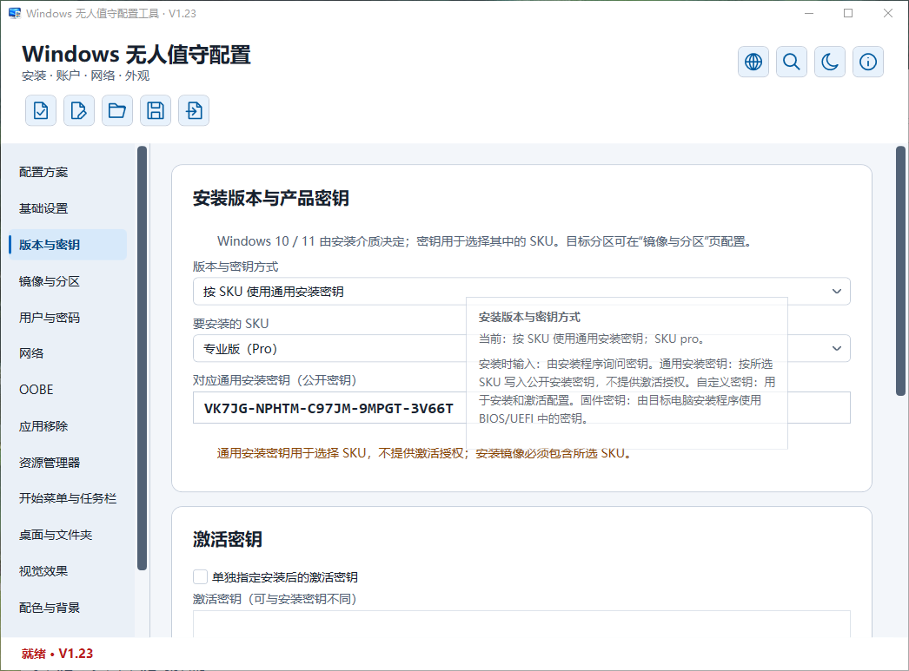
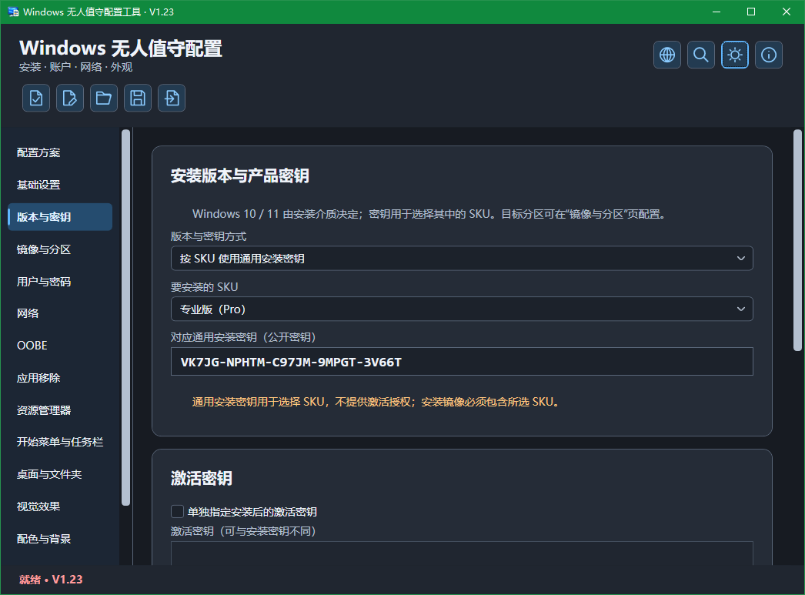

# UnattendLocal — Windows 无人值守配置工具


**简体中文** | [English](README_EN.md)

UnattendLocal 是基于 [Christoph Schneegans 的 UnattendGenerator](https://github.com/cschneegans/unattend-generator) 开发的 Windows 桌面配置工具，支持简体中文与英语界面，用于在本地编辑、检查和生成 Windows 10 / 11 的 `autounattend.xml`。

当前版本：**V1.28**。支持简体中文 / English 即时切换、独立语言包维护、静态 IPv4 / IPv6 双栈、子网掩码输入、设置搜索、安装驱动目录、动态更新、自动分区、OOBE 与账户配置，以及已有 XML 的导入编辑。

## 💡 开发初衷

> 方便自己在本地离线配置，也方便下一次直接复用。

最初做 UnattendLocal，是想给自己准备一个可以在本地离线使用的 Windows 安装配置工具。把常用设置保存成方案，重新安装系统或换一台电脑时，直接载入，再根据实际环境调整，让重复的准备工作更省心。

项目以 Christoph Schneegans 的成熟生成核心为基础，将常用选项整理成中文桌面界面，并补上方案保存、配置摘要、检查预览和已有 XML 的导入编辑。希望从选择设置到生成文件，整个过程都更直观，也更容易核对。

现在把它公开，也希望方便有同样需求的人使用，并通过大家的实际测试逐步完善。开发会继续保持小步推进，优先做好常用功能、配置可靠性和安装验证。

这里的离线使用指在本地编辑、保存与生成配置；微软账户登录、联网下载图片或其他联网脚本，仍取决于目标安装环境的网络条件。

## 📸 运行截图

以下为 **V1.23 Windows 实际运行截图**，分别展示简体中文浅色与深色界面；最新功能以本页更新说明为准。

| 简体中文 · 浅色主题 | 简体中文 · 深色主题 |
| :---: | :---: |
|  |  |

图中的产品密钥为公开通用安装密钥，仅用于选择安装版本，不提供激活授权。

## ✨ 主要功能

- 即时切换简体中文与英语界面；语言资源独立存放，支持增量翻译维护。

- 按目标网卡 MAC 分别配置静态 IPv4 / IPv6，可同时启用双栈；指定地址、前缀、网关和 DNS，IPv4 在同一框填写子网掩码或 /前缀长度。

- 通过右上角“帮助与关于”查看版本、使用说明和内置第三方许可，支持离线查阅，项目地址可直接点击访问。

- 通过顶部放大镜或 Ctrl+F 搜索中英文设置名称与别名，按页面分类筛选，切页定位并高亮结果。
- 指定目标 Windows 的工作组名称与 PE 阶段日志目录，保留域加入等未知配置的原文。
- 独立配置 Windows 注册所有者与组织名称，保留登录账户、计算机名与激活设置的独立性。
- 配置安装架构、显示语言、区域、键盘、时区、计算机名及安装版本 / 产品密钥。
- 配置镜像选择、已有分区或自动分区、系统分区大小、分区前暂停及 CompactOS；涉及清空或格式化时显示风险说明并要求核对。
- 配置安装阶段动态更新与界面显示行为，以及目标 Windows PE 可访问的 INF 驱动目录。
- 配置本地账户、内置 Administrator 首次登录、密码、密码到期与锁定策略，以及 WPA2 / WPA3 / 开放 Wi-Fi、无线配置 XML、离线安装和 OOBE。
- 配置资源管理器、开始菜单、任务栏、系统桌面图标、视觉效果、配色、纯色或图片背景及锁屏图片。
- 按项选择 60 个应用与系统能力移除项目，提供中文影响说明、关键词搜索和选择摘要，默认不勾选。
- 配置 `$OEM$` 安装介质配置集与 AppLocker 策略 XML，提供策略编辑及结构检查。
- 配置讲述人辅助安装、Edge 卸载入口和 C 盘系统还原行为，三项默认不勾选。
- 配置 VMware、VirtualBox、KVM / QEMU（VirtIO）和 Parallels 的工具安装，附带所需介质及作用范围说明。
- 配置常用系统行为，包括快速启动、长路径、系统声音、设备自动加密、硬件关联应用、更新自动重启、NTFS 最后访问时间、进程创建审计、UAC / WPBT 及远程桌面 / PowerShell 执行策略等选项。
- 按原设计管理 System、DefaultUser、FirstLogon、UserOnce 自定义脚本；支持复制条目，副本默认停用供核对。
- 保存和恢复 JSON 方案，提供配置摘要、推荐差异、检查、脱敏预览和 XML 导出。
- 导入已有 XML 后编辑已支持设置，保留未知内容；遇到无法可靠合并的修改时停止导出并说明原因。

## V1.28 部署检查与配置可靠性改进 · 2026-10-28

- 收紧 PE 分区映射检查：实际映射分区数与磁盘报告不一致，或已映射卷的盘符无法识别时，停止目标选择及分区前复核。
- 修复停用的 PE 自定义选盘脚本进入 XML 恢复记录的问题；仅保留实际启用的脚本，JSON 方案继续保存草稿。
- 统一自定义选盘脚本的 CR、LF 与 CRLF 换行校验，修复仅使用 CR 时可绕过行数限制的问题。
- JSON 导入递归拒绝重复字段，并在兼容性迁移前拒绝字符串字段的 null 值，避免歧义配置和空引用异常。
- 复用已验证的 JSON 解析结果，减少方案载入时的重复解析。
- 补充分区检查、配置恢复与 Windows 选盘脚本模拟用例。
- 修复英文界面导出检查弹窗的账户位置与悬停提示中文残留；直达按钮显示为“Go to”，悬停提示补全用途和目标位置，并修复文字截断。
- 统一搜索、主题切换、颜色选择及配置摘要等悬停提示的本地化显示。
- 修复英文 XML 预览顶部磁盘说明、预览警告和密码等遮蔽占位符的中文残留；已有预览随界面语言切换，用户文本、脚本及实际导出内容保持原样。

使用说明：[PE 脚本安装](docs/GeneratedPe.md)。

<details>
<summary>历史更新（点击展开）</summary>

## V1.27 磁盘部署安全与启动兼容性增强 · 2026-10-27

- PE 脚本安装支持固定编号、按条件唯一匹配、安装时交互及自定义 VBScript 四种选盘方式；旧方案仍默认固定编号，不自动切换安装路径。
- 支持容量范围、可选匹配编号、无分区、IDE/SCSI 接口及固定介质条件；容量按字节比较，无匹配或多个匹配时停止，不自行选择第一个。
- 在分区前记录并复核磁盘编号、设备标识、容量和启动方式；复核位于可选暂停之后，查询失败、条件不符或目标变化时拒绝工具生成的破坏性分区调用。
- 排除能够映射到安装镜像、应答文件或 PE 系统盘的目标，保留清盘确认；修改选盘条件、脚本及相关参数后需重新确认。
- 支持 x64 PE 的 UEFI/GPT、BIOS/MBR 和跟随启动方式布局；固定布局不匹配时中止，UEFI 专用 bcdedit 仅在 GPT 路径执行。
- 自定义选盘脚本须在 60 秒内输出一个有效编号，异常退出、错误输出、多个编号或额外文字均拒绝；脚本为可信可执行代码，不属于安全沙盒。
- 补齐中英文界面、搜索、参数定位、配置摘要、JSON 保存及有效原始 XML 恢复编辑，并处理 PE 命令行长度限制。
- 附带六项最小虚拟机验收清单及 Windows 选盘脚本模拟测试。

使用说明：[PE 脚本安装](docs/GeneratedPe.md) · [部署验证](docs/PeDeploymentValidation.md)。

## V1.26 MSI 安装与 Windows 沙盒 · 2026-10-27

- 新增“本地 MSI 静默安装（通用）”脚本模板，在 System 阶段执行，添加后默认停用。
- 支持填写本地 MSI 完整路径和可信 SHA256，复制并校验安装包后调用系统 Windows Installer；不下载或自动扫描安装包。
- 使用静默安装与禁止重启参数，等待安装结束；返回码 3010 仅提示稍后重启，其他非零返回码明确报错，不自动重试。
- 首阶段适用于资源内嵌的单文件 MSI，不支持外部 CAB、MST、MSP、UNC 路径及额外安装参数。
- 新增“启用 Windows 沙盒”模板，在首次管理员登录阶段启用系统组件及依赖；已启用时跳过，待重启时仅提示。
- 沙盒模板添加后默认停用，禁止自动重启，不从 Windows Update 获取缺失组件；不支持、源缺失或状态异常时明确报错。
- 两项模板均支持中英文名称、用途与使用条件、设置搜索、方案保存及本程序 XML 恢复编辑；已有脚本内容保持原样。
- 保留 V1.25 的 PE 基础安装模式及中英文界面排版修复。

使用说明：[实用脚本模板](docs/ScriptTemplates.md)。

## V1.25 PE 基础安装流程 · 2026-10-27

- 新增默认关闭的 PE 脚本安装模式，首阶段支持 x64、UEFI/GPT、清空指定目标磁盘及按镜像索引安装。
- 统一 PE 功能的中英文选项名称、帮助、配置摘要及搜索用语，按功能用途直接描述。
- 修复“镜像与分区”页多段说明仅首行缩进的问题，统一按段落左对齐。
- 全面检查选项排版：状态摘要和短提示左对齐，中文正文保留适当首行缩进并统一各段，英文保持左对齐。
- 按风险、准备事项与责任说明整理磁盘风险提示，统一段首缩进，收紧段间距，并同步英文内容。
- IPv4/IPv6 内容区统一拉伸铺满，与公共说明左对齐；仅页签标题居中，选中样式不影响正文颜色和字重。
- 复用固定生成核心完成磁盘选择、分区、释放镜像、写入引导及重启，保留镜像完整性检查。
- 在分区前核对 x64 PE、UEFI 启动方式、镜像索引及镜像架构；不匹配时停止，不进入分区。
- 支持分区前暂停和 PE 完成后重启前暂停，保留清盘确认、方案保存、原始 XML 恢复编辑及中英文搜索与说明。
- 常规安装方式保持默认。明确阻止暂不兼容的安装驱动目录、动态更新、PE 日志、Compact OS、硬件检查绕过及 windowsPE 额外 XML 组合。
- 沿用最新版第三方引用与鸣谢文档，网址标签统一为“项目 / Project”，保留完整版权与许可。

使用说明：[PE 脚本安装](docs/GeneratedPe.md)。

## V1.24 计算机命名、临时更新暂停与安全修复 · 2026-10-26

- 新增按 MAC 地址生成计算机名：使用唯一物理以太网适配器生成 PC- 加 12 位 MAC 的名称，无匹配或多个匹配时明确报错。
- 新增安装阶段临时暂停更新一小时模板：保留已有更晚的到期时间，不关闭更新服务或建立持续暂停任务，添加后默认停用。
- 修复外部语言包占位符校验的正则回溯风险，改用有界的非回溯匹配，并对校验超时安全拒绝。
- “帮助与关于”主页保留本项目 GitHub 超链接，点击使用默认浏览器打开；保留生成核心来源说明，上游地址及完整许可集中在开源许可与来源文档中。
- 移除关于、法律信息与使用说明、开源许可三页共用的底部关闭与整页复制按钮，统一保留窗口右上角关闭。
- 按语义分段整理关于页和法律说明，增加阅读行距与段间距；组件与授权说明支持中英文，组件及许可文档中的网址可直接点击访问。
- 更新中英文浅色、深色运行截图，明确标注为 V1.23 实机截图。
- 删除主页顶部重复下载链接，仅保留“下载与使用”段落的 Release 入口；历史更新继续完整折叠保留。

使用说明：[计算机命名](docs/ComputerNameAndLanguages.md)、[脚本模板](docs/ScriptTemplates.md)。

## V1.23 通用应用安装模板与高级诊断 · 2026-10-26

- 脚本操作按钮集中放在脚本列表正上方，说明文字置于工具栏之前，减少滚动和查找。
- 左侧导航按当前语言最长选项自动统一列宽，名称单行显示，预留选中加粗空间，避免切换页面时宽度跳动。
- 将应用安装入口按方式整理为“WinGet 应用安装（通用）”和“本地 EXE 静默安装（通用）”，不为每个软件单独增加模板。
- WinGet 模板需填写包 ID；EXE 模板需填写安装包路径、SHA256 和厂商静默参数。Chrome、7-Zip 仅作为文档使用示例。
- 保留可选的高级防火墙丢弃日志模板，只调整日志选项，不修改过滤规则。
- 模板添加后默认停用；已有方案和 XML 中的脚本正文保持原样，不因模板重组而自动替换。
- 保留模板名称显示、脚本正文复制修复；中英文主页仅展开最新版更新，历史内容完整保留在折叠区。

使用说明：[实用脚本模板](docs/ScriptTemplates.md)。

## V1.22 系统盘卷标与卓越性能模板 · 2026-10-25

- 修复自定义脚本模板下拉列表错误显示完整模板对象和脚本正文的问题；列表仅显示模板名称，长名称自动换行，弹出列表宽度与选择框一致。
- 修复脚本内容区的复制按钮误复制占位说明的问题，改为复制当前完整脚本正文；正文为空时禁用，并保留复制结果提示。
- 新增“设置系统盘卷标”脚本模板：自动识别系统盘，校验 NTFS 卷标，不格式化或修改分区。
- 新增“启用卓越性能电源计划”脚本模板：创建并激活专用计划，重复执行复用已有计划；不支持时明确报错。
- 两项模板位于自定义脚本页，添加后默认停用，支持命名、编辑、方案保存和本程序导出 XML 的恢复编辑，配有中英文说明。
- Release 发布后先检查附件：已有 EXE 则跳过自动构建；没有 EXE 才构建两种程序并自动附加。普通提交和单独创建标签均不触发 EXE 构建。
- 上传前再次检查，保留已有附件、标题和更新说明；手动构建只生成 Actions 产物。

## V1.21 部署设置与语言菜单修复 · 2026-10-25

- 修复语言菜单切换时可能瞬间出现双对勾的问题，统一管理单选状态。
- 新增“禁止新建 NTFS 8.3 短文件名”：默认不修改，只禁止后续创建，不删除已有短文件名。
- 新增“自定义 C 盘分页文件”：支持初始及最大容量校验，在系统安装阶段应用，保留其他盘符的分页文件；默认不修改。
- 补齐两项设置的中英文说明、设置搜索、配置摘要、方案保存和本程序导出 XML 的恢复编辑。
- 仅在推送版本标签（如 v1.21）时自动构建两种 EXE，普通提交不触发 EXE 构建；保留手动构建入口，Release 由用户手动发布。

使用说明：[部署设置](docs/DeploymentTuning.md)。

## V1.20 简体中文与英语界面 · 2026-10-25

- 新增简体中文 / English 即时切换，记住界面语言；界面语言与目标 Windows 的安装语言分别设置。
- 页面标题、选项、帮助、摘要、诊断和确认提示统一接入独立 JSON 语言资源，长说明分段并自动换行。
- 程序旁的 `Languages` 目录支持独立更新译文；缺少文件时使用内置资源，异常语言包校验失败后保留有效译文。
- 提供稳定资源键、翻译状态检查，以及与服务无关的翻译任务导出 / 导入工具，便于后续增量维护和自动化翻译。
- 保持旧方案取值、原始 ID、脚本、用户输入及生成 XML 的兼容性；程序压缩包包含可编辑语言文件。

使用与维护：[国际化与语言包](docs/Localization.md)。

## V1.19 应用安装与桌面快捷方式模板 · 2026-10-25

- 新增“通过 WinGet 安装 Google Chrome”模板，在 FirstLogon 阶段等待 WinGet 出现后，通过社区源按精确 ID 静默安装；默认不升级已有版本，不绕过哈希验证，并检查安装返回码。
- 新增“创建公共桌面快捷方式”模板，在 System 阶段创建所有用户可见的程序或网页链接。默认附带系统属性和项目下载页示例，可编辑名称与目标；公共桌面由系统解析，不固定盘符。
- 快捷方式列表在写入前检查文件名、目标及重名；已有同名文件或文件夹保留，使用临时文件生成链接，失败时清理临时文件。
- 两项能力继续保留原作者的示例脚本分类，添加后默认停用，可查看和修改完整内容，支持方案保存及 XML 导出、重新导入。

使用条件与示例：[实用脚本模板](docs/ScriptTemplates.md)。

## V1.18 网络诊断模板与脚本命名 · 2026-10-24

- 新增“允许局域网 Ping”模板：仅在专用和域网络中允许本地子网发来的 IPv4 / IPv6 回显请求；不关闭防火墙、不新增公用网络放行。重复执行更新本工具的规则，遇到其他程序占用同名规则时停止。
- 新增“关闭受邀 Windows 远程协助”模板：在 System 阶段关闭传统远程协助的本机受邀连接开关，保留现有 RDP、快速助手及第三方远控设置。
- 自定义脚本支持可编辑名称；模板自动带入名称，列表显示“名称 · 阶段 · 格式”。名称随方案保存并由本工具的有效 XML 还原记录恢复，复制脚本也保留名称；不改变执行命令或脚本文件名。
- 构建验证将预期的模拟安装警告留在测试内部，输出明确的模拟测试说明和检查结果，减少与真实构建故障混淆。

功能说明：[实用脚本模板](docs/ScriptTemplates.md)。

## V1.17 实用脚本模板 · 2026-10-23

- 自定义脚本页新增模板选择器：离线安装 .NET Framework 3.5、安装微软 Visual C++ v14 运行库、禁用所有驱动器的 AutoRun。分别显示用途、执行阶段与使用条件，可通过设置搜索定位。
- 模板添加后默认停用并自动选中，可核对、修改、启用或删除；相同内容不会重复添加。继续支持方案保存、XML 导出与重新导入。
- .NET 3.5 模板只使用安装介质中的本地源，不回退到 Windows Update；内部版本 28000 及以上停止并提示改用独立安装程序。
- VC++ 模板按目标系统选择架构，64 位系统同时安装 x86 包；下载后验证有效的微软 Authenticode 签名，再等待安装结束、检查返回码并清理临时文件，不主动重启。
- 修复发布脚本对省略零版本段的比较；手动构建增加版本、源码提交及文件摘要信息。程序打包继续仅由手动触发。

模板说明：[实用脚本模板](docs/ScriptTemplates.md)。

## V1.16 文件导入与保存优化 · 2026-10-23

- 统一应答 XML、JSON 方案、无线配置、AppLocker 策略和开始菜单 / 任务栏布局的文件读取逻辑，在读取过程中持续检查大小上限。
- 严格检查 UTF-8 及带 BOM 的 UTF-16 / UTF-32 编码；遇到损坏字节时停止导入并显示中文处理说明，避免静默替换字符。有效文本、换行及已有大小上限保持不变。
- 脚本另存和主题偏好保存复用方案 / XML / ISO 使用的临时文件替换逻辑，先完整写入并刷新，再替换目标文件；保存失败时保留原文件并尝试清理临时文件。
- 核对上游 27237f8：安装时输入计算机名的功能已包含在 V1.15 中，无需重复合并。

## V1.15 电源计划与 Windows 错误报告 · 2026-10-22

- 新增首选电源计划设置：支持不指定、平衡、高性能、节能及自定义 GUID，在 specialize 阶段配置目标系统已有的电源计划，不创建或导入计划。
- 新增 Windows 错误报告（WER）设置：支持不指定、启用和禁用，采用微软原生 DisableWER 设置，不停用服务，也不代表关闭所有诊断数据。
- 支持两项设置的 JSON 保存、原生 XML 导入编辑、配置摘要、设置搜索及错误定位；默认均不指定。
- 未识别的值、重复项和其他执行阶段只读保留；修改已识别设置时保留同组件的其他原文内容。
- 兼容 V1.14 的额外 XML 编辑来源及旧 JSON 编辑基准，避免重复控制同一组件或恢复已停用的配置。
- 复用原生标量设置的检查及迁移逻辑，减少重复解析；新增说明遵循中文分段与悬停补充规则。

使用方法与官方依据见 [电源计划与错误报告](docs/NativePreferences.md)。

## V1.14 快捷预设与高级 XML 组件 · 2026-10-22

- 新增“最小配置”预设：安装时选择语言、版本、分区及账户，其余常用设置采用 Windows 默认行为；默认保留安装隐私文件。
- 新增“仅创建本地账户”预设：沿用原作者 Example 管理员账户、空密码和首次自动登录一次的示例，可继续修改账户名、密码与权限；新建前显示说明和替换确认。
- 新增额外 XML 组件编辑器：支持最多 15 项，选择微软组件与执行阶段后添加设置子元素；保留已有生成内容，重复顶层设置阻止导出。
- 提供 OEM 支持信息示例，支持片段结构检查、设置搜索及错误定位；新增条目和示例默认停用。
- 额外 XML 支持 JSON 保存与本程序导出 XML 的往返编辑；预览整体遮蔽额外内容，省略敏感内容保存时清空片段并要求重新填写。
- 完善说明排版：页面按用途分段，悬停提示补充限制与细节，增加说明行高。

使用方法见 [快捷预设与额外 XML](docs/AdvancedXml.md)。结构检查不代替目标镜像的 Windows SIM 检查和实际安装验证。

## V1.13 应答文件导出增强 · 2026-10-21

- 优化 ISO 导出界面：采用光盘图标，精简页面说明并分段显示，悬停提示补充手动加载与凭据保管说明。
- 新增 `notautounattend.xml` 文件名选项，用于通过 `setup.exe /Unattend:实际路径` 显式指定应答文件；此选择可随 JSON 方案保存，旧方案默认仍使用 `autounattend.xml`。
- 新增应答文件 ISO 导出，根目录包含所选名称的一份完整 XML，可作为虚拟机的附加光驱介质；ISO 不含 Windows 镜像，不能独立启动。
- 两种格式共用当前配置检查、完整 XML 生成、磁盘风险确认及临时文件替换保存；切换文件名不改变安装配置或原 XML 合并逻辑。
- 补齐说明、设置搜索与 ISO 组件的离线许可证。ISO 与 XML 均可能包含安装所需凭据，需妥善保管。

导出方法见 [应答文件 XML 与 ISO 导出](docs/AnswerFileExport.md)。

</details>

## 📦 下载与使用

推荐下载程序 ZIP 并完整解压，保留 EXE 旁的 `Languages` 文件夹，以便单独更新译文。仅运行 EXE 时仍有内置中英文资源回退。详见[语言包说明](docs/Localization.md)。

从仓库的 [**Releases**](https://github.com/tigerJX95/UnattendLocal/releases/latest) 页面下载并直接运行对应的 `UnattendLocal_V1.25_x64_SelfContained.exe` 或 `UnattendLocal_V1.25_x64_FrameworkDependent.exe`：

| 程序文件 | 运行要求 |
| --- | --- |
| `UnattendLocal_V1.25_x64_SelfContained.exe` | 集成 .NET 运行时，无需单独安装；通常选择此版。 |
| `UnattendLocal_V1.25_x64_FrameworkDependent.exe` | 文件较小，需安装 .NET 10 Desktop Runtime x64。 |

两版功能相同。首次安装测试建议使用虚拟机。

1. 选择推荐场景或自定义配置，填写账户、镜像等必要信息。
2. 按需要选择系统、外观及应用移除设置。
3. 点击“检查与预览”，核对摘要及待处理项，再导出实际 XML。
4. 将 `autounattend.xml` 放在目标安装介质根目录；遮蔽后的预览不能代替实际 XML。

可通过“打开方案”恢复 JSON，也可通过“导入应答 XML”继续编辑已有应答配置。方案省略凭据后，重新打开可能需要补填密码 / 密钥；导入原 XML 未保存时需要重新导入。

## 📖 使用说明

### 相关文档

- 静态网络操作与范围见 [IPv4 / IPv6 配置](docs/StaticIP.md)。
- V1.0 定位与范围见 [版本说明](docs/V1Scope.md)。
- 关于与许可入口见 [帮助与关于](docs/About.md)。
- 首次登录选项见 [首次登录说明](docs/FirstLogon.md)。
- XML 导入与取消行为见 [导入说明](docs/XmlImport.md)。
- 设置搜索操作见 [搜索说明](docs/SettingsSearch.md)。

### 兼容联接点

- 兼容联接点选项按 ReparsePoint 属性删除指定范围的项目，可能包含其他重解析点；不恢复已删除的链接，请先在虚拟机验证。

### 计算机命名

- 在“基础设置”选择命名方式。
- 固定名称留空时仍由 Windows 自动生成；安装时输入会中断无人值守流程，需完成有效输入才能继续。
- 脚本必须返回一个有效计算机名（1–15 个字符，不能是纯数字或包含非法符号，也不应与本地账户同名）；工具不会执行或预先验证脚本结果。
- 命名脚本按原文保存在方案和 XML 中，分享前检查敏感信息。

### 语言与键盘

- 第二、第三组语言与键盘在“指定语言与区域”模式下生效，不安装语言包，也不改变本工具的中文界面。
- 交互选择语言时保留这些设置，但不写入固定语言配置。

### 系统保护与根目录权限

- 四项设置位于系统设置页，默认均不勾选，遵循 Windows 默认行为。
- 关闭 SAC、SmartScreen 或核心隔离会降低相应保护；SAC 关闭后重新启用可能需要重置或重装 Windows。
- SmartScreen 选项还会隐藏安全中心托盘图标，但不关闭 Defender 防病毒引擎。
- 核心隔离选项不卸载 Hyper-V、WSL2 或虚拟机工具，不保证性能提升；系统版本、组织策略和固件锁定可能影响结果。
- 根目录权限收紧可能影响依赖普通用户向 C 盘根目录写入的程序，不改变整个磁盘或其他盘的权限。

### 设置变更与 XML 编辑

- 取消勾选仅影响新生成配置，不恢复已安装系统。
- 导入 XML 仅对完整识别的原生流程开放编辑，未知或修改过的内容保留原文并拒绝不可靠覆盖。

### `$OEM$` 配置集

- `$OEM$` 开关只生成安装设置；需自行准备与 `autounattend.xml` 配套的介质目录。
- `$$` 对应 Windows 目录，`$1` 对应系统盘根目录。
- 复制可能覆盖同路径内容，不会自动安装其中的应用；不要预先建立未来用户的个人目录。
- 自定义 PE 脚本中的复制流程保留原文，不能由此开关可靠控制。

### AppLocker 策略

- AppLocker 在 specialize 阶段启动 AppIDSvc 并执行 Set-AppLockerPolicy，不带 `-Merge`，可能替换现有本地策略。
- 强制规则可能拦截安装脚本、系统工具或管理员应用；先在虚拟机审核并准备恢复方案。
- 结构检查不判断规则是否适合目标电脑，生效取决于 Windows 版本、组件和组织策略。
- 策略始终保存在 JSON 中，省略凭据不会移除其中的路径、SID 或自行填写的信息；预览整体遮蔽策略 XML。
- 取消仅改变新配置，不恢复已安装系统。

### 无线网络与无线配置 XML

- WPA3 需目标系统、无线驱动和接入点支持；开放网络没有无线链路加密，可能仍需门户认证。
- 无线配置 XML 可能含明文密码或其他认证资料，省略凭据时不保存整段无线 XML；自动连接时配置名称需与 SSID 一致，加密密钥不能可靠迁移。
- 证书和驱动仍需另行准备。

### 讲述人

- 启用讲述人后不会自动关闭朗读；定制 PE 可能缺少语音或音频支持。

### Edge 卸载入口

- 允许卸载 Edge 只尝试调整系统策略文件，不实际卸载、不移除 WebView2，可能因系统版本、权限或更新而不生效。

### C 盘系统还原

- 关闭 C 盘系统还原可能删除已有还原点，不能只当作暂停创建还原点。

### UAC 与 WPBT

- 关闭 UAC 会降低权限提升保护；阻止 WPBT 不修改固件、不卸载已有软件，可能影响厂商通过该机制提供的程序。

### 虚拟机工具与 PE 驱动

- 虚拟机工具需挂载官方工具介质并与目标 Windows / 架构匹配；未找到时不安装。
- VirtIO Guest Tools 不替代 Windows PE 阶段驱动，导入 XML 中已有的 PE 驱动脚本按原文保留。

### 命令行审计

- 命令行审计会将参数明文写入安全日志，可能含凭据；仅启用审计时不会强制关闭已有命令行记录策略。

### Windows 更新与重启

- 更新重启策略受 Windows 版本、组织策略、截止期限或用户安排的重启影响，不保证阻止全部重启；启用后需自行安排重启完成更新。

### NTFS 最后访问时间

- NTFS 最后访问时间设置可能影响依赖此时间的归档、备份或清理规则。

### 桌面与锁屏图片

- 桌面图片脚本必须返回图片原始字节，安装时需能访问图片；锁屏效果受版本和策略限制。

### 应用移除

- 应用移除可能影响相关功能，取消勾选不恢复已安装系统的应用。

### 远程桌面与 PowerShell 策略

- 远程桌面需要目标版本支持，RemoteSigned 的有效策略可能被更高优先级策略覆盖。

### 敏感信息与磁盘操作

- 导出的 XML、包含凭据的 JSON 和自定义脚本可能含敏感内容。
- 分享前自行移除密码、密钥和令牌；预览整体遮蔽无线配置 XML，不会自动识别任意脚本中的敏感信息。
- 磁盘清空 / 格式化可能删除数据，请核对目标磁盘并完成备份。

## 🛠️ 从源码生成

使用 Visual Studio 2026 与 .NET 10 SDK，安装“.NET 桌面开发”，打开仓库根目录的 `UnattendLocal.sln`。四个项目为 Desktop、Core、vendor/UnattendGenerator、Tests，默认将 Desktop 设为启动项目。

也可在源码根目录手动执行：

```powershell
dotnet restore UnattendLocal.sln
dotnet build UnattendLocal.sln -c Release -m:1 -nr:false
dotnet publish Desktop/Desktop.csproj -c Release -m:1 -nr:false -r win-x64 --self-contained true -p:PublishSingleFile=true -p:IncludeNativeLibrariesForSelfExtract=true -o publish/win-x64
```

## 🙏 引用与鸣谢

- **Christoph Schneegans**：[上游生成器源码](https://github.com/cschneegans/unattend-generator) · [原作者网站](https://schneegans.de/windows/unattend-generator/) · [使用说明](https://schneegans.de/windows/unattend-generator/usage/) · [脚本示例](https://schneegans.de/windows/unattend-generator/samples/)。本项目以其成熟生成核心为基础进行中文界面与本地适配。
- **James Newton-King 与 Newtonsoft.Json 贡献者**：[Newtonsoft.Json](https://github.com/JamesNK/Newtonsoft.Json)，用于上游生成核心的数据处理。
- **Microsoft / .NET 与 WPF 贡献者**：[.NET](https://github.com/dotnet/runtime) · [WPF](https://github.com/dotnet/wpf)，提供桌面与运行环境。
- **ChatGPT / Codex（OpenAI）**：[ChatGPT](https://chatgpt.com/) · [Codex](https://openai.com/codex/)。在需求梳理、代码实现、问题排查、中文说明与文档整理过程中提供辅助支持。

保留上游版权及 MIT 许可证，见 [vendor/UnattendGenerator/LICENSE.txt](vendor/UnattendGenerator/LICENSE.txt)。第三方记录与固定基线说明随完整源码包提供。本地工具不是原作者的官方桌面发行版。

## 💬 反馈

欢迎提交 Issues，说明工具版本、Windows 环境、复现步骤、预期与实际结果。安装问题请补充目标镜像版本、版本类型、架构与出现阶段。日志或配置只提供脱敏后的最小复现内容。

## 📖 项目许可证

本项目本地界面与适配代码采用 [MIT License](LICENSE)，Copyright (c) 2026 tigerJX95。第三方组件保留原版权及许可，见 [第三方声明](THIRD_PARTY_NOTICES.md)。完整许可也可在程序“帮助与关于 → 开源许可”中离线查看。
