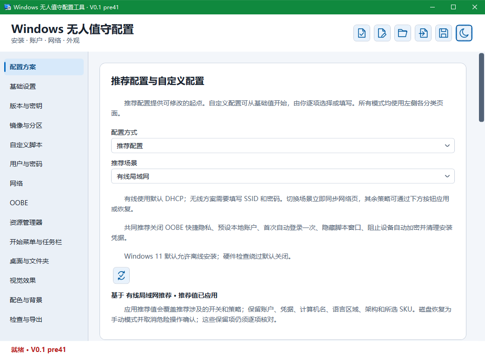
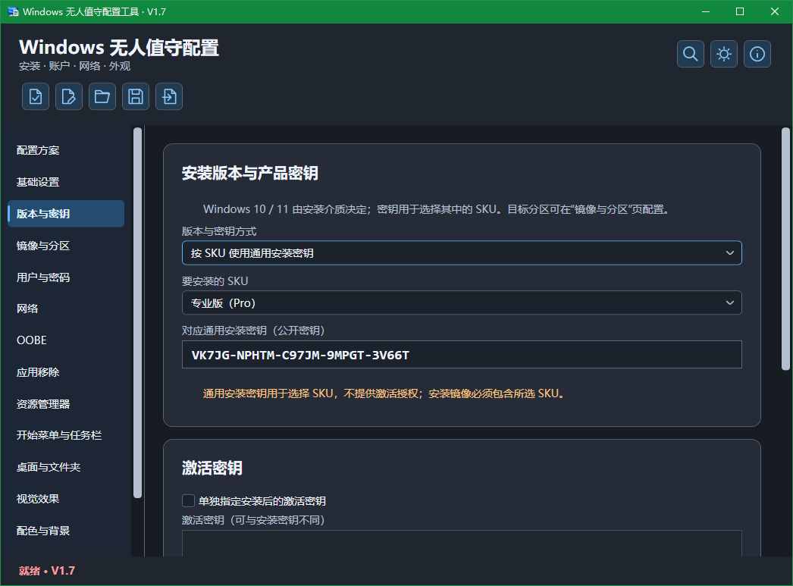

# UnattendLocal — Windows Unattended Setup Configuration Tool

[简体中文](README.md) | **English**

UnattendLocal is a Chinese-language Windows desktop tool based on [Christoph Schneegans’ UnattendGenerator](https://github.com/cschneegans/unattend-generator). It lets you edit, check, and generate `autounattend.xml` for Windows 10 / 11 locally.

Current version: **V1.4**. This release adds installation-stage Dynamic Update alongside driver directories, script-file import/save-as, static IPv4, automatic partitioning and XML import/editing. The tool prepares installation configuration; it does not run generated scripts on your current computer.

## 💡 Why this project exists

> Configure Windows installations offline, and reuse the settings next time.

UnattendLocal started as a personal tool for preparing Windows installation settings locally without relying on an online editor. Saving common settings as a plan makes it easier to reinstall Windows or prepare another computer: load the plan, adjust it for the target environment, and reuse the work.

The project builds on Christoph Schneegans’ established generation core, organizes common options into a Chinese desktop interface, and adds saved plans, configuration summaries, checks, previews, and editing of existing XML. The aim is to make settings easier to understand and verify before generating a file.

Publishing the project makes it available to people with similar needs and allows practical feedback to guide improvements. Development proceeds in small steps, prioritizing common features, configuration reliability, and installation testing.

Offline use means editing, saving, and generating configuration locally. Microsoft account sign-in, image downloads, and other network-dependent scripts still depend on connectivity in the target installation environment.

See [first-logon options](docs/FirstLogon.md) and [XML import behavior](docs/XmlImport.md) for replacement, cancellation and read-only script handling.

## 📸 Screenshots

| Configuration plans · Light theme | Edition and product key · Dark theme |
| :---: | :---: |
|  |  |

These are actual V0.1 pre41 screenshots showing the light and dark themes. The current V1.4 release includes navigation changes and additional settings; refer to the current application for the latest interface. The application interface is currently in Chinese.

## ✨ Main features

- Leave Windows networking unchanged by default, or configure a static IPv4 address, prefix, gateway and DNS by target adapter MAC without changing the current computer.

- View the version, usage notices and embedded third-party licenses through Help and About, with offline reading and copying.

- Search settings through the toolbar magnifier or Ctrl+F using Chinese/English names and aliases, then navigate and highlight the result.
- Configure architecture, display language, region, keyboard, time zone, computer name, installation edition, and product keys.
- Configure image selection, existing or automatic partitioning, system-partition sizing and a pre-partition pause, and CompactOS. Destructive disk operations include risk explanations and confirmation.
- Configure installation-stage Dynamic Update and UI behavior, plus INF driver directories accessible from target Windows PE.
- Configure local accounts, passwords, initial sign-in, password expiration and lockout policies, Wi-Fi, offline installation, and OOBE.
- Configure File Explorer, the Start menu, taskbar, desktop icons, visual effects, colors, backgrounds, and lock-screen images.
- Select among 60 application and system capability removal items, with Chinese impact descriptions, keyword search, and a selection summary. Items are unchecked by default.
- Configure `$OEM$` media configuration sets and AppLocker policy XML, with policy editing and structural validation.
- Configure Narrator-assisted setup, the Edge uninstall option, and system protection on drive C:. All three are unchecked by default.
- Configure guest tool installation for VMware, VirtualBox, KVM / QEMU (VirtIO), and Parallels, with media requirements and scope descriptions.
- Configure common system behavior, including Fast Startup, long paths, system sounds, automatic device encryption, device-associated apps, Windows Update restart behavior, NTFS last-access timestamps, process creation auditing, UAC/WPBT, Remote Desktop, and Windows PowerShell execution policy.
- Manage System, DefaultUser, FirstLogon, and UserOnce custom scripts using the original execution-stage design. Duplicate scripts with copies disabled by default for review.
- Save and restore JSON plans; review summaries, recommended-setting differences, checks, redacted previews, and XML exports.
- Import existing XML and edit supported settings while preserving unknown content. Export stops with an explanation when changes cannot be merged reliably.

## ✨ V1.4 updates

- Added installation-stage Dynamic Update: leave Setup defaults unchanged, enable it or disable it. No override is written by default.
- Independently configure update UI behavior: default, on error, never or always.
- Integrated native XML import/editing, reset to defaults, saved plans, summaries, help and setting search.
- Unrecognized update settings and custom PE flows are clearly read-only and retain their original XML. Older plans migrate only when the editing baseline can be matched reliably, preserving other pending edits.
- The publishing script reads the project version and checks both EXEs, preventing stale version names.

[Setup Dynamic Update](docs/SetupDynamicUpdates.md) · [Installation driver directories](docs/SetupDrivers.md)

## 📦 Download and usage

Download and run the matching Windows x64 executable from the repository’s **Releases** page: `UnattendLocal_V1.4_x64_SelfContained.exe` or `UnattendLocal_V1.4_x64_FrameworkDependent.exe`. Choose `UnattendLocal_V1.4_x64_SelfContained.exe` for a bundled .NET runtime, or `UnattendLocal_V1.4_x64_FrameworkDependent.exe` if .NET 10 Desktop Runtime x64 is already installed. Both have the same features. Use a virtual machine for initial testing.

1. Choose a recommended scenario or a custom configuration and enter the required account and image settings.
2. Adjust system, appearance, and application removal options as needed.
3. Open checks and previews, review the summary and outstanding items, then export the actual XML.
4. Place `autounattend.xml` in the root of the target installation media. A redacted preview cannot replace the actual XML.

Open a JSON plan to restore saved settings, or import an answer XML to continue editing an existing configuration. Plans saved without credentials may require passwords or keys to be entered again. If the imported original XML was not saved with the plan, import it again.

## 📖 Scope and limitations

See [static IPv4 configuration](docs/StaticIPv4.md) and [V1.0 scope](docs/V1Scope.md).

See [Help and About](docs/About.md) for the information window and license texts.

Choose the naming mode in basic settings. Leaving the fixed name empty still lets Windows generate it. The installation-time dialog requires valid input before setup can continue. A naming script must return a valid computer name (1–15 characters, not entirely numeric, without invalid characters, and different from local account names). The tool does not run the script or verify its runtime result. Scripts are stored verbatim in plans and XML; check for sensitive information before sharing.

The second and third locale/keyboard pairs apply in fixed language/region mode. They do not install language packs or change this tool’s Chinese interface. Interactive language selection retains these settings in the plan without writing fixed language settings.

The four options appear in system settings and are unchecked by default, leaving Windows behavior unchanged. Disabling SAC, SmartScreen, or core isolation reduces the corresponding protection. Re-enabling SAC may require a Windows reset or reinstall. The SmartScreen option also hides the Windows Security tray icon but does not disable the Defender antivirus engine. The core-isolation option does not uninstall Hyper-V, WSL2, or VM tools and does not guarantee better performance; Windows version, organization policies, and firmware locks can affect results. Restricting C: root permissions may affect programs that expect ordinary users to write there; it does not change permissions throughout the disk or on other drives.

Clearing an option changes newly generated configuration only; it does not restore an installed system. The tool does not execute these commands on the current computer. XML editing is available for complete recognized native flows; unknown or modified content is preserved and unreliable replacements are rejected.

The `$OEM$` option generates installation settings only. Prepare the media folders alongside `autounattend.xml`: `$$` maps to the Windows directory and `$1` to the system-drive root. Copying can replace matching files and does not automatically install applications. Do not pre-create future users’ personal profile folders. Custom PE copying scripts are preserved and cannot be reliably controlled by this switch.

AppLocker starts AppIDSvc and runs Set-AppLockerPolicy during specialize without `-Merge`, potentially replacing the existing local policy. Enforced rules can block setup scripts, system tools, or administrator applications; audit them in a VM and prepare recovery first. Structural checks cannot establish whether a policy is suitable. Results depend on Windows version, components, and organization policy. JSON always retains policy text, including when credentials are omitted; review paths, SIDs, and other entered information before sharing. Preview hides the entire policy XML. Clearing the option changes new configuration only and does not restore an installed system.

This version is published as an ordinary GitHub Release. Some non-core upstream settings will be implemented later. The project uses a fixed generation core with selective synchronization and does not claim complete parity with the latest upstream features.

WPA3 requires compatible Windows, wireless drivers, and access points. Open Wi-Fi does not encrypt the wireless link and may require a captive portal. Wireless profile XML may contain credentials; saving without credentials omits the whole profile. Automatic connection requires the profile name to match the SSID; encrypted keys are not portable. Prepare required certificates and drivers separately. Narrator remains enabled until adjusted in Windows accessibility settings; customized PE media may lack speech or audio support. The Edge option only attempts a policy-file change: it does not uninstall Edge or WebView2, and Windows updates may revert it. Disabling System Restore on C: can delete existing restore points and removes that recovery path. Disabling UAC reduces elevation protection. Blocking WPBT does not modify firmware or uninstall software and may affect programs provided through that mechanism. VM guest tools require attached official tool media compatible with the target Windows version and architecture. Missing media means no installation. VirtIO Guest Tools do not replace Windows PE drivers; existing PE driver scripts in imported XML are preserved. Command-line auditing writes arguments in plain text to the security log and may expose credentials. Enabling only auditing does not force existing command-line capture policies off. Restart behavior depends on Windows version, organization policies, update deadlines, and user-scheduled restarts; this option does not guarantee preventing every restart. Schedule restarts yourself to complete updates. Disabling NTFS last-access updates may affect archival, backup, or cleanup rules that depend on those timestamps. Desktop image scripts must return raw image bytes, and the image must be accessible during installation. Lock-screen behavior depends on Windows edition and policies. Removing applications may affect related features; clearing a removal selection does not restore applications on an already installed system. Remote Desktop requires a supported target edition. Higher-priority policies may override RemoteSigned.

Exported XML, JSON plans containing credentials, and custom scripts may contain sensitive data. Remove passwords, keys, and tokens before sharing. Preview hides the whole wireless profile, but does not automatically identify secrets inside arbitrary scripts. Disk wiping and formatting may delete data; verify the target disk and back up first.

## 🛠️ Build from source

Use Visual Studio 2026 and the .NET 10 SDK with the .NET desktop development workload. Open `UnattendLocal.sln` at the repository root. The solution contains Desktop, Core, vendor/UnattendGenerator, and Tests; Desktop is the default startup project.

Run `build.cmd` to publish both single-file EXEs. The script reads the project version, checks the published EXE versions, and writes directly to `UnattendLocal-release/v1.4/` beside the source directory. Existing release files are not overwritten. Use `build.cmd -CreateZip` if additional ZIP archives are required.

Alternatively, run these commands from the source root:

```powershell
dotnet restore UnattendLocal.sln
dotnet build UnattendLocal.sln -c Release -m:1 -nr:false
dotnet run --project Tests/Tests.csproj -c Release --no-build
dotnet publish Desktop/Desktop.csproj -c Release -m:1 -nr:false -r win-x64 --self-contained true -p:PublishSingleFile=true -p:IncludeNativeLibrariesForSelfExtract=true -o publish/win-x64
```


## 🙏 Credits

- **Christoph Schneegans**: [upstream source](https://github.com/cschneegans/unattend-generator) · [website](https://schneegans.de/windows/unattend-generator/) · [usage guide](https://schneegans.de/windows/unattend-generator/usage/) · [script examples](https://schneegans.de/windows/unattend-generator/samples/). This project builds on his generation core with a Chinese interface and local desktop integration.
- **James Newton-King and Newtonsoft.Json contributors**: [Newtonsoft.Json](https://github.com/JamesNK/Newtonsoft.Json), used by the upstream generation core for data processing.
- **Microsoft / .NET and WPF contributors**: [.NET](https://github.com/dotnet/runtime) · [WPF](https://github.com/dotnet/wpf), providing the desktop and runtime infrastructure.
- **ChatGPT / Codex (OpenAI)**: [ChatGPT](https://chatgpt.com/) · [Codex](https://openai.com/codex/). Assisted with requirement refinement, implementation, troubleshooting, Chinese-language guidance, and documentation.

Upstream copyright and the MIT license are retained in [vendor/UnattendGenerator/LICENSE.txt](vendor/UnattendGenerator/LICENSE.txt). Third-party notices and fixed-baseline details are included in the full source package. This tool is not the original author’s official desktop distribution.

## 💬 Feedback

Please open an Issue with the tool version, Windows environment, reproduction steps, and expected and actual behavior. For installation issues, include the target image version, edition, architecture, and the stage where the issue occurred. Share only redacted logs or minimal reproduction configurations.

## 📖 Project license

The local UI and adaptation code are licensed under the [MIT License](LICENSE), Copyright (c) 2026 tigerJX95. Third-party copyrights and licenses are retained in [third-party notices](THIRD_PARTY_NOTICES.md). Full texts are also available offline through Help and About → Open-source Licenses.
